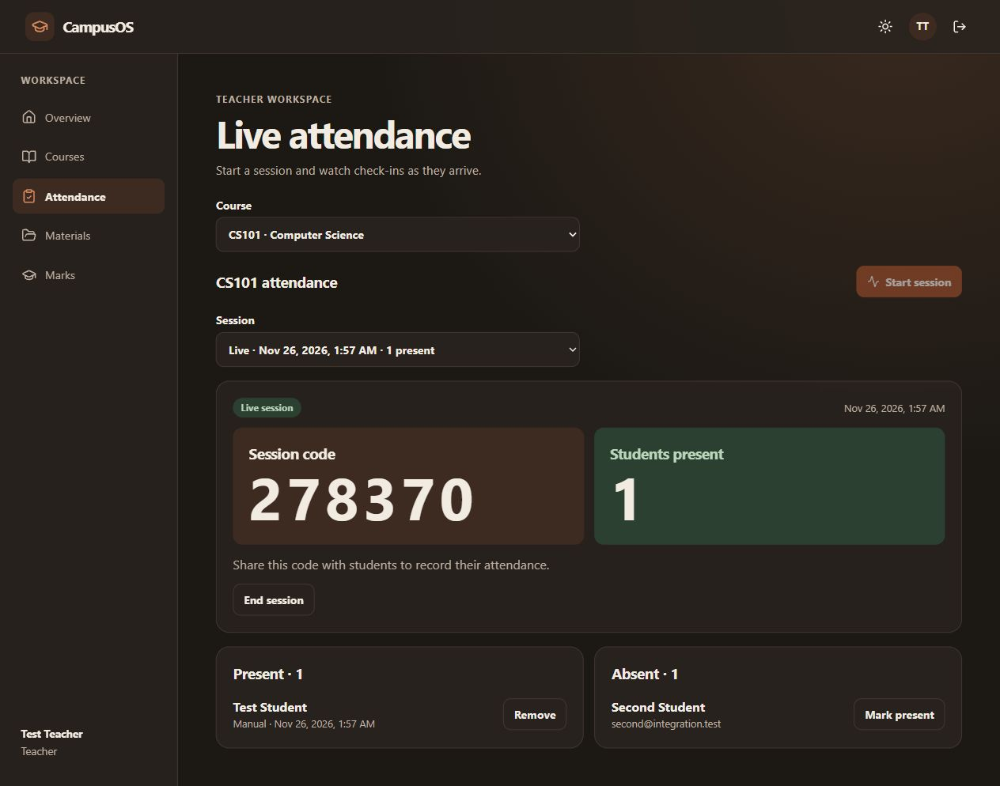
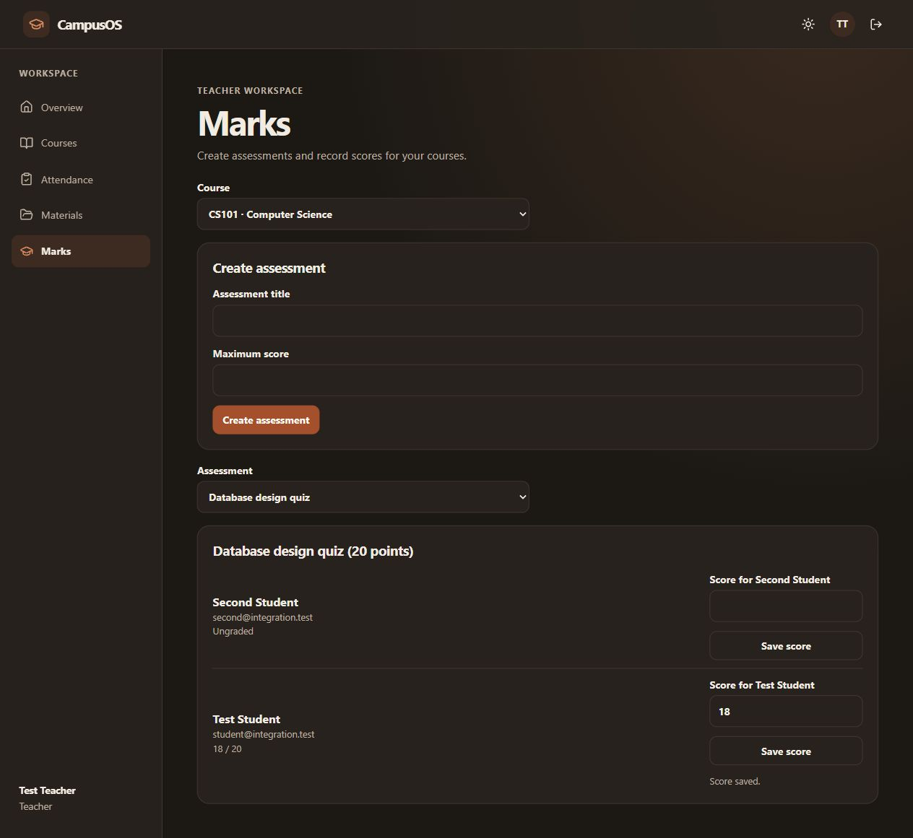

# CampusOS

CampusOS is a DBMS course project for managing courses, enrollments, attendance, materials, and assessment scores from one web app.

| Role | What you can do |
| --- | --- |
| Admin | Create teacher and student accounts, assign teachers to courses, and manage course rosters. |
| Teacher | Find and enroll students, run live attendance sessions, share course materials, and record assessment scores. |
| Student | Check in with a session code and view your attendance history, course materials, and individual results. |

## Quick start

Install Node.js 24 with npm. From the repository root, open two terminals.

**Terminal 1 — API**

```sh
cd frontend
npm ci
npm run test:prepare
npm run test:server
```

**Terminal 2 — web app**

```powershell
cd frontend
$env:VITE_USE_MOCKS = 'false'
npm run dev
```

On macOS or Linux, run `VITE_USE_MOCKS=false npm run dev` from `frontend/`.

Open the local URL printed by Vite, usually `http://127.0.0.1:5173`. Sign in as `teacher@integration.test` with `CampusOS-Local-Test-Only` to try CS101. The demo uses in-memory SQLite and resets when the API restarts.

See [all demo accounts and walkthroughs](docs/demo.md) or [set up a persistent database](backend/README.md#install-and-run).

## Screenshots





## Project layout

| Path | Contents |
| --- | --- |
| [frontend/](frontend/README.md) | React, TypeScript, and Vite application |
| [backend/](backend/README.md) | Fastify API and SQLite migrations |
| [docs/](docs/architecture.md) | Architecture, demo guide, and project history |

See the [contribution guide](CONTRIBUTING.md), [changelog](CHANGELOG.md), and [project history](docs/project-history/README.md).
